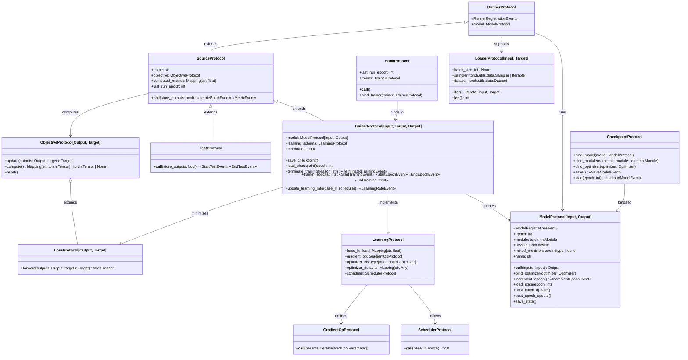

# Types and Protocols

## Core Types
Throughout drytorch, generic variables must satisfy these constraints:

- `Input` and `Target`: `torch.Tensor` | `MutableSequence[torch.Tensor]` | `NamedTuple`
- `Output`: no constraints
- `Data`: 2-tuple where both elements follow `Input`/`Target` constraints

**Note**: The notation for the generic variables has been simplified to ignore
subtype relationships.

## Diagram

The following diagram maps the dependencies between the core interfaces using UML-style notation:

- **Generalization (<|–):** one protocol extends another and inherits its
  members.

- **Structural Association (–>):** Represents a structural requirement and is often implemented using Dependency Injection.

- **Dependency (..>):** Represents a logical dependency that is not enforced by the protocol but often necessary for its implementation.

- **Members:** those marked with `+` are methods or read-only properties; the
  others are attributes that implementations may reassign.

- **Events:** names in «guillemets» are events. Among the attributes, they
  are emitted when an instance is created; after a method, by the method.

